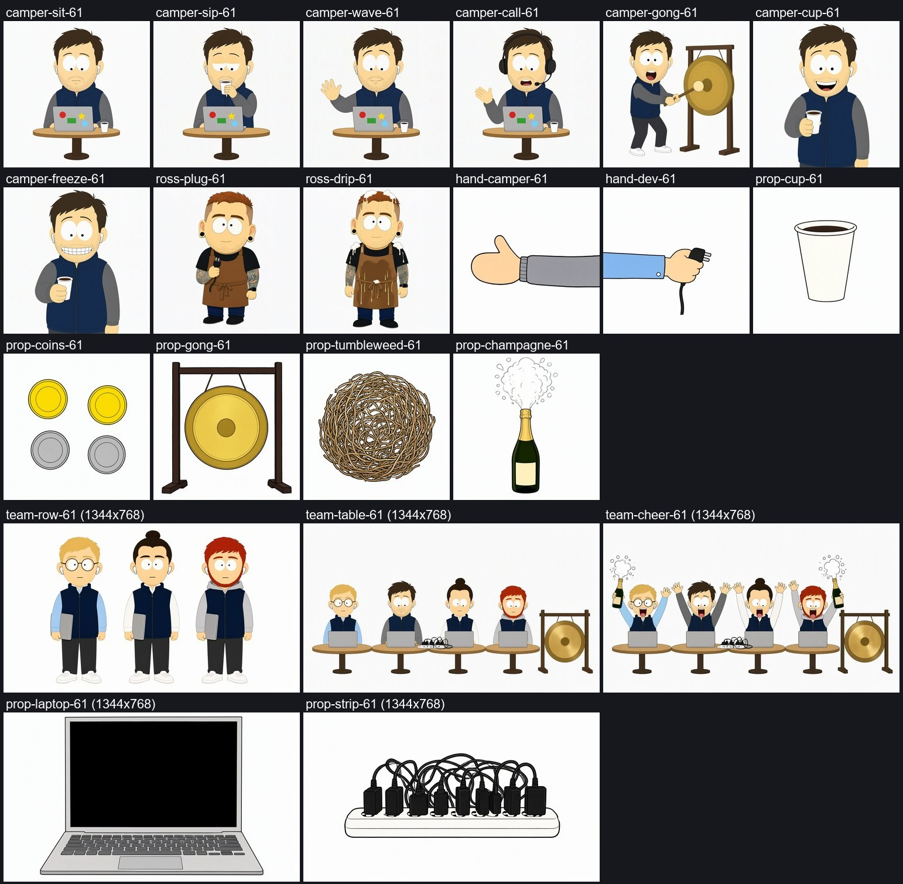
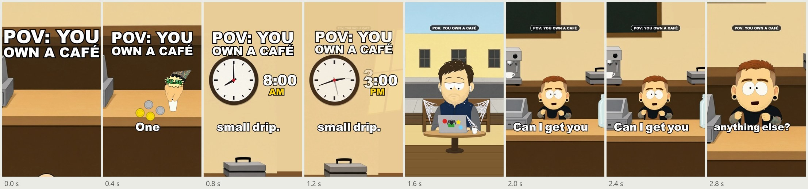
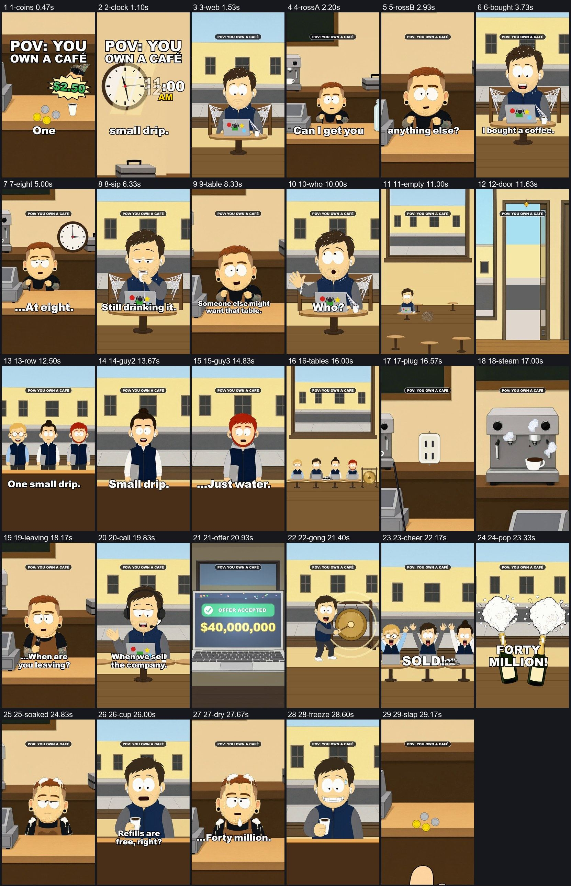

# ai-cartoon-reels

Short South Park-style cartoon reels, 20 to 30 seconds, 1080 x 1920, made on one Windows PC. Claude Code writes the screenplays, hands the work to subagents and runs the checks. The pictures come from Qwen Image, the voices, sounds and music from ElevenLabs, and the animation is three.js inside Remotion.



*The art for x20 "One Coffee": 21 pictures painted with Qwen Image 2.1 Turbo, one per pose or prop, each on plain white.*



*The first 3 seconds of the finished reel, a frame every 0.4 s. A new picture every 0.4 to 1 s is one of the format rules.*



*The finished reel as a contact sheet: 29 shots in 29.5 s, a still from each.*

This is the working repo of a series of cartoons about running a small business, made for GetPhantom's Instagram and TikTok. The code of every episode, from the pilot to x20, is in `src/` and `scripts/`, and each one is a worked example. It is a record of how we made them and a base to copy from. It is not a packaged tool: a new episode means new files, written on the pattern of the last one. [docs/x20-one-coffee.md](docs/x20-one-coffee.md) follows one episode from the topic to the finished render, with the script, the test room, the shot list, the build notes and the checks.

The characters are original. The look is a paper cut-out style close to South Park's, and nothing here uses the show's characters, logos or fonts. The project has no connection to South Park or its makers.

## Check the repo without generating anything

```
npm install
npx tsc --noEmit             # type-checks src/ and scripts/
node scripts/x20-check.mts   # the schedule checks of the worked example
node scripts/eyes-check.mts  # every pupil stays inside its eye
```

These need no pictures, voices or API keys. A fresh clone cannot render an episode, because the pictures, voices and sounds are not included (see "What is not included").

## How an episode is made

An episode has an id such as `x20`. Its files are `episodes/x20.jsonc`, `src/X20.tsx` and `src/x20-*`, `scripts/x20-*`, `scripts/render-x20.sh` and the notes in `docs/x20-one-coffee.md`.

Claude Code is the coordinator. The main session holds the script, the rules and the owner's notes. It starts cheap subagents for the test readers (Haiku) and stronger ones for the art and the build (Sonnet), looks at what they return, and sends fixes. In our runs the owner picked the topic, usually one of three pitches, and looked at the result. The approval stops between steps are switched off, so an episode runs from topic to a finished v1. The screenwriting skill still has a "wait for yes" step if you want a human gate.

Commands below use three names for Python interpreters. Set them once in Git Bash:

```
PY_AUDIO=python    # numpy, faster-whisper
PY_IMG=python      # numpy, scipy, opencv-python, pillow
PY_WANGP=C:/path/to/Wan2GP/env_uv/Scripts/python.exe   # WanGP's own Python
```

### 1. Script and test room

Write the screenplay with the screenwriting skill ([skills/screenwriting](skills/screenwriting/SKILL.md)). To use the skills in Claude Code, copy `skills/screenwriting` and `skills/humanizer` into `~/.claude/skills/`. Read [docs/format.md](docs/format.md) first, then [docs/bible.md](docs/bible.md) and [docs/reel-rules.md](docs/reel-rules.md). The result is `docs/<ep>-<slug>.md` with the screenplay, three hooks, the beats and a shot list on the voices' clock. We run the text we write through the humanizer skill to strip AI-sounding patterns. The rules for the cartoon lines themselves are in docs/bible.md.

Then run the test room ([prompts/test-room.md](prompts/test-room.md)): five cheap readers get only the script and answer a few questions. At most two rounds. The readers show whether a beat reads. They do not pick the peak.

`node scripts/writers-room.mjs <ep>` is an older, automated route (premise, beats, critics, rewrites) that runs on Anthropic API credits.

### 2. Voices

`episodes/<ep>.jsonc` holds the lines. Each line has three voice directions (ElevenLabs v4 tags plus stability and style), and the file names the cast, the take picked for each line, the gaps that carry the silent beats, and the lead.

```
node scripts/voices.mjs                      # lists your ElevenLabs voices, writes scratch/voices.json
node scripts/voice-gen.mjs x20 --tries 3     # three takes per line -> scratch/voice-raw/x20/
$PY_AUDIO -I scripts/voice-analyze.py x20/   # pitch, flatness and speed of every take
$PY_AUDIO -I scripts/voice-check.py scratch/voice-raw/x20/camper-1-adam/L01-t1.mp3   # Whisper: every scripted word heard?
# pick one take per line in "plan" of episodes/x20.jsonc, then:
$PY_AUDIO -I scripts/voice-build.py x20      # -> public/x20/*.mp3, public/x20/timings.json, out/x20-table-read.mp3
$PY_AUDIO -I scripts/amp-build.py x20        # -> src/amp-x20.json, the mouth openness per frame
```

`CAST` in `scripts/voice-gen.mjs` maps each character to ElevenLabs voice ids. Every id must be in your account, or `voice-gen.mjs` stops at that character. Add the voices from ElevenLabs' voice library, or edit `CAST`. `public/x20/timings.json` is the clock of the episode: every later step hangs on its word times.

### 3. Sounds and music

```
node scripts/sfx-gen.mjs sfx x20-gong 3 "a big brass gong struck once, a long ring"   # -> scratch/sfx-raw/x20-gong.mp3
node scripts/sfx-gen.mjs music x20-music 32 "mellow acoustic jazz, like a small radio"
```

Copy the clips into `public/sfx-src/`, add a line for each to `PLAN` in `scripts/sfx-build.py` (trim, fades, level), then run `$PY_AUDIO -I scripts/sfx-build.py` to build `public/sfx/`. `$PY_AUDIO -I scripts/sfx-peaks.py` writes `src/sfx-peaks.json`, the measured peak of each clip, so that a hit can be placed with its peak on the frame of the picture's impact.

### 4. Art

Qwen Image 2.1 Turbo 7B paints every character, prop and background from a text prompt, with one reference picture per recurring character. Each episode has its own script, `scripts/<ep>-art-gen.py`, that holds the prompts and calls WanGP's Python API:

```
$PY_WANGP -I scripts/x20-art-gen.py                  # every picture -> out/x20-cast/<name>-61.png
$PY_WANGP -I scripts/x20-art-gen.py camper-sit prop-cup
```

Seed 61 for every picture. Run it in the foreground, one WanGP job at a time, at most 5 pictures per call (a picture takes 20 to 90 s). Look at every picture, and paint again only the ones that are broken. [prompts/art-agent.md](prompts/art-agent.md) is the brief for the art subagent. It hands back a contact sheet (the first picture on this page) and a `DONE.txt` that lists the weak spots.

We tried SDXL first, with South Park LoRAs. One of them broke the style and the other drew the show's own characters. That is why the art comes from Qwen Image by prompt alone. `scripts/sd-gen.py` is what is left of the SDXL route.

### 5. Puppets

```
$PY_IMG -I scripts/x20-prep.py          # all parts; or name them: props people ross team
```

The prep script cuts each painted picture into transparent parts (the white background is removed by a flood fill from the border, with cleaners for halos and pockets of paper), measures the eyes, the pupils and the mouth, and writes `public/sp/x20-*.png` and `src/x20-rig.json`. The measured numbers let the code draw lids, pupils and a talking mouth over the painted face. Debug sheets go to `scratch/x20-prep`.

### 6. Animation

Each shot is a React component in `src/x20-scenes.tsx`. It draws the cut-outs as textured planes in a three.js scene (`@remotion/three`, an orthographic camera, front-on), and animates them the way the show is animated: paper cut-outs with small moves. Code draws screens, captions, effects, lids, pupils and the mouths, which follow the voice loudness from `src/amp-x20.json`. The timeline, `src/x20-sched.ts`, is built on `public/x20/timings.json`. Every motion is a function of `useCurrentFrame()`, so every render comes out the same.

```
npx remotion studio src/index.ts                  # preview
node scripts/x20-stills.mts && node scripts/still.mjs scratch/x20-job.json   # stills of the key frames
```

[prompts/build-agent.md](prompts/build-agent.md) is the brief for the build subagent, in two phases: phase 1 before the art is in (with stand-ins for the pictures), phase 2 after.

### 7. Render

```
sh scripts/render-x20.sh          # checks, cues, mix, silent render, mux, phone copy, cover, QA
V=v2 sh scripts/render-x20.sh     # keep v1, write the v2 files
AUDIO=1 sh scripts/render-x20.sh  # stop after the mix and the speech check
```

It writes `out/x20-v1.mp4` (1080 x 1920, 30 fps), `out/x20-v1-phone.mp4` (a smaller copy), `-cover.jpg`, `-sheet.jpg` and `-first3.jpg`. The audio is mixed by `scripts/sp-mix.py` to -14 LUFS with a true peak under -1.5 dBTP after AAC. The silent render of the 885 frames of x20 took 60 s on the RTX 3060.

### 8. Checks

| Command | What it checks |
|---|---|
| `node scripts/x20-check.mts` | no shot over 2.4 s, no two same framings in a row, captions out of the bottom 400 px, every cut and hit within half a frame of the shot list |
| `node scripts/eyes-check.mts` | every pupil stays inside its eye white at every look |
| `$PY_IMG -I scripts/pops-check.py out/x20-v1-silent.mp4` | one-frame pops (a flash that lasts a single frame) |
| `sh scripts/loud.sh out/x20-v1.mp4` | integrated loudness, range and true peak |
| `$PY_AUDIO -I scripts/stt-lines.py out/x20-v1.mp4` | Whisper hears every line on the final mix |
| `node scripts/x20-caps-job.mts`, `node scripts/still.mjs scratch/job-caps.json`, `$PY_IMG scripts/caps-check.py 250 1500` | where the captions sit |
| `$PY_IMG -I scripts/first3-strip.py out/x20-v1.mp4 out/x20-v1-first3.jpg` | the first 3 seconds as a strip, for the test readers |
| `$PY_AUDIO -I scripts/x20-voice-over.py` | how far each voice line sits over the sounds |

The checks run on the Whisper large-v3 model on the CPU. `HF_HUB_OFFLINE` is set to 1 in the scripts, so run the first Whisper check once with `HF_HUB_OFFLINE=0` to download the model.

## The format in short

The rules are in [docs/format.md](docs/format.md). The short version:

- One sketch of 20 to 30 s, no shot over 2.4 s.
- The first 3 s: something happens in the first 0.5 s, on a sound. The oddest picture is on screen by 1 s. A new picture every 0.4 to 1 s. It reads with the sound off, and it leaves a question open.
- A ladder: it opens on something everyone has lived through, each punch is bigger than the last and follows from it, and it ends off the rails.
- An open ending. The last shot leads back into frame one, so the reel loops.
- About 40 to 60 words, in lines a real person says. Bleeped swearing, no moral, no share line, no handle and no end card in the video. Any ask goes in the caption.
- A label such as "POV: YOU OWN A CAFÉ" names the situation. Key text stays out of the bottom 400 px and the right 130 px, where Instagram covers the picture.
- The reel's first frame is its cover, because TikTok takes frame 0.
- Judge an episode after 24 h by shares and comments per view, profile visits and follows, not by views.

## Requirements

- A Windows PC with an NVIDIA GPU with 12 GB of memory. This runs on an RTX 3060 12 GB.
- Node 24 and npm. The `.mts` scripts run directly under Node.
- Git Bash, for the `sh scripts/render-*.sh` scripts, and `ffmpeg` on the PATH.
- Python 3.11 or 3.12 for the analysis and prep tools. The audio tools need `numpy` and `faster-whisper`. The image tools need `numpy`, `scipy`, `opencv-python` and `pillow`. A few old scripts also use `torch` and `spandrel` (the 4x upscalers), `mediapipe` (`lip-lag.py`) or `diffusers` (`sd-gen.py`). One environment with all of these is enough.
- [WanGP](https://github.com/deepbeepmeep/Wan2GP) with the model Qwen Image 2.1 Turbo 7B (read its license under "Credits and licenses"). The scripts start it with `--attention sage2 --profile 4`.
- An ElevenLabs account, for voices (model eleven_v4), sound effects and music.
- Claude Code. An Anthropic API key is only for the optional `writers-room.mjs` and the clip check in `shots.py`.

Remotion downloads its own headless Chrome the first time it renders.

## Folder map

```
src/        the engine and every episode's scenes
              sp-puppet.tsx, sp-fx.tsx, sp-eyes.ts, sp-math.ts   puppets, effects, pupil arithmetic, number helpers
              flat.tsx, chars.tsx, props.tsx                      the first, code-drawn kit
              x20-sched.ts, x20-scenes*.tsx, x20-draw.tsx ...     one set of files per episode
              Root.tsx                                            registers every composition
scripts/    voices, sounds, art, prep, checks and render scripts; most come per episode
episodes/   one .jsonc per episode: lines, voice directions, picked takes, gaps
docs/       the rules (format, bible, reel-rules, production) and two worked examples (x19, x20)
  img/      the pictures on this page
prompts/    the three subagent briefs: test-room.md, art-agent.md, build-agent.md
skills/     screenwriting (a Claude Code skill) and humanizer (MIT, Siqi Chen)
public/     only the small timings.json and edit.json files that src/ imports
```

`docs/production.md` is the first working order, written for an earlier route that used AI video clips. Its first steps still apply. The note at its top says which.

## What is not included

- Model weights: WanGP, Qwen Image, Whisper and RealESRGAN. You install them yourself.
- API keys. `.env.example` lists the two names the scripts read, `ELEVENLABS_API_KEY` and `ANTHROPIC_API_KEY`.
- The generated media: voices (`public/<ep>/*.mp3`, `scratch/voice-raw`), sounds and music (`public/sfx-src`, `public/sfx`, `public/music`), art and cut-outs (`out/<ep>-cast`, `public/sp`), and every video. You generate your own. The sound names in `src/<ep>-sched.ts` (`stamp`, `pop`, `click`, and the ones named after an episode) are the names in `PLAN` of `scripts/sfx-build.py`, which builds them from source clips that you generate.
- The cast pictures of the first episodes and the reference picture of the owner's character.
- The git history. This repo starts fresh. Comments and docs cite commit hashes of the original private repo. `scripts/render-fx-test.sh` builds its "before" render from one of those commits, and `scripts/fx-sheet.py` uses its stills, so those two cannot run here.
- The notes of the other episodes. Comments in `src/`, `scripts/` and `episodes/` point at `docs/x12-speak-to-the-manager.md` and similar files. Only the x19 and x20 notes are included.

`public/<ep>/timings.json` and the few `edit.json` files are included, although the voices behind them are not. They are text and word times, and the schedules in `src/` import them, so `tsc` and the check scripts run on a clone.

## Edit these paths

The scripts keep the paths of the machine they were written on, a Windows PC with the drive E:. Nothing was rewritten for this copy, so change the ones in the scripts you run. For a new episode that is the `PY=` line and the three `E:/Invoke/...` lines in `scripts/render-<ep>.sh`, and the top of `scripts/<ep>-art-gen.py` (the WanGP folder, the output folder, the avatar and master pictures). To find every occurrence:

```
grep -rnE "[A-Za-z]:[\\/](Invoke|talking-reel|Wan2GP|getphantom-toons|Windows)" scripts src
```

| Path | What it is | Used by |
|---|---|---|
| `E:/talking-reel/.venv/Scripts/python.exe` | Python with numpy and faster-whisper (voice, sound, mix and Whisper tools) | the `PY=` line of every `render-*.sh`, the usage lines of the audio scripts (45 files) |
| `E:/Invoke/.venv/Scripts/python.exe` | Python with numpy, scipy, OpenCV and Pillow (prep, sheets, strips, pops check) | the `render-*.sh` files, the usage lines of the prep scripts (54 files) |
| `E:/Wan2GP/env_uv/Scripts/python.exe` | WanGP's own Python | the usage lines of the art scripts (28 files) |
| `E:\Wan2GP` | the WanGP folder, in `sys.path.insert(0, r"E:\Wan2GP")` and `init(root=...)` | every `*-art-gen.py`, `sp-props-gen.py`, `shots.py`, `lips8real-*.py` (22 files) |
| `E:\Wan2GP\my_tests\avatar\ross-avatar-southpark.png` | the reference picture of the owner's character (not included) | `x08-art-gen.py` to `x20-art-gen.py` |
| `E:\Wan2GP\my_tests\sp_cast.py` | the first art script, named in comments only (not included) | six art scripts |
| `E:\getphantom-toons\out\<folder>\...` | the old repo root: art folders of earlier episodes, read as references and masters | the `*-art-gen.py` scripts |
| `E:/Invoke/models/53add48b-a5c7-41cc-958e-d6d87b26f6ff/RealESRGAN_x4plus.pth` | RealESRGAN weights | `tip-upscale.py`, `because-upscale.py` |
| `C:/Windows/Fonts/segoeui.ttf`, `C:/Windows/Fonts/{name}` | system fonts | `first3-strip.py`, `lips8real-cut.py` |

<details>
<summary>All distinct paths, one by one</summary>

```
C:/Windows/Fonts/segoeui.ttf
C:/Windows/Fonts/{name}
E:/getphantom-toons/out/lips8-real/
E:\getphantom-toons
E:\getphantom-toons\out\lips8-real\refs
E:\getphantom-toons\out\sp-cast2
E:\getphantom-toons\out\sp-cast3
E:\getphantom-toons\out\sp-cast4
E:\getphantom-toons\out\sp-cast5
E:\getphantom-toons\out\sp-cast5\denise-chair-phone-61.png
E:\getphantom-toons\out\sp-cast6
E:\getphantom-toons\out\sp-cast7
E:\getphantom-toons\out\x08-cast
E:\getphantom-toons\out\x08-cast\ross-hand-61.png
E:\getphantom-toons\out\x08-cast\ross-sit-61.png
E:\getphantom-toons\out\x09-cast
E:\getphantom-toons\out\x10-cast
E:\getphantom-toons\out\x10-cast\bg-counter-61.png
E:\getphantom-toons\out\x10-cast\chuck-61.png
E:\getphantom-toons\out\x11-cast
E:\getphantom-toons\out\x12-cast
E:\getphantom-toons\out\x13-cast
E:\getphantom-toons\out\x14-cast
E:\getphantom-toons\out\x15-cast
E:\getphantom-toons\out\x16-cast
E:\getphantom-toons\out\x16-cast\hand-ross-61.png
E:\getphantom-toons\out\x17-cast
E:\getphantom-toons\out\x18-cast
E:\getphantom-toons\out\x18-cast\mom-phone-61.png
E:\getphantom-toons\out\x18-cast\toddler-pour-61.png
E:\getphantom-toons\out\x19-cast
E:\getphantom-toons\out\x19-cast\customers-61.png
E:\getphantom-toons\out\x20-cast
E:/Invoke
E:/Invoke/.venv/Scripts/python.exe
E:/Invoke/models/53add48b-a5c7-41cc-958e-d6d87b26f6ff/RealESRGAN_x4plus.pth
E:/talking-reel/.venv/Scripts/python.exe
E:/Wan2GP
E:/Wan2GP/env_uv/Scripts/python.exe
E:\Wan2GP
E:\Wan2GP\my_tests\avatar\ross-avatar-southpark.png
E:\Wan2GP\my_tests\sp_cast.py
```

</details>

In the docs these interpreters are written as `$PY_AUDIO`, `$PY_IMG` and `$PY_WANGP`.

## Credits and licenses

Our own code and docs are MIT, see [LICENSE](LICENSE). The pieces below keep their own licenses.

- [three.js](https://threejs.org), MIT, with `@react-three/fiber` and `@react-three/drei`.
- [Remotion](https://www.remotion.dev) has its own license. It is free for individuals and small companies. Read https://www.remotion.dev/license before you use it in a larger company.
- [WanGP](https://github.com/deepbeepmeep/Wan2GP) is under the WanGP Community License 2.0. You may use it for free, including inside a company, and you may sell the outputs. You are asked to credit WanGP when you directly sell or license an output. You may not sell WanGP itself or offer hosted access to it. Models run by WanGP keep their own licenses.
- Qwen Image 2.1 is published by the Qwen team under the Qwen Research License Agreement (dated 2026-09-20, the model card is tagged `qwen-research`). The license text grants rights for non-commercial purposes only, defined as research or evaluation, and requires a separate license from the Qwen team for any commercial purpose. It says little about the outputs. If you post the pictures for a business, read the license at https://huggingface.co/Qwen/Qwen-Image-2.1 and settle it before you post. Earlier Qwen-Image releases were under Apache 2.0.
- ElevenLabs: whether you may use voices, sound effects and music commercially depends on your plan. Check their terms.
- [skills/humanizer](skills/humanizer/SKILL.md): MIT, copyright Siqi Chen, license file included. It is based on Wikipedia's "Signs of AI writing".
- [CloudAI-X/threejs-skills](https://github.com/CloudAI-X/threejs-skills): MIT. The screenwriting skill points to it for three.js reference. Its files are not copied here.
- The screenwriting skill was assembled from ideas in [jtydhr88/screenwriting-skills](https://github.com/jtydhr88/screenwriting-skills) (MIT), [talsraviv/comedy-writers-room](https://github.com/talsraviv/comedy-writers-room) (that repo has no license file: the test room uses its idea of writer and audience subagents, and you should ask its author before you reuse anything beyond the idea) and the "screenwriter" and "threejs-builder" skills from mcpmarket.com (their licenses were not checked).
